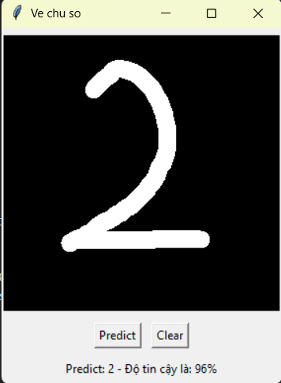

# Handwritten Digit Recognizer (MNIST + Tkinter)

Ứng dụng desktop cho phép **vẽ một chữ số bằng chuột** và nhận dự đoán chữ số đó cùng độ tin cậy, dùng mô hình Logistic Regression huấn luyện trên bộ dữ liệu MNIST.

## Demo



## Tính năng

- Vẽ chữ số trực tiếp trên canvas 280x280
- Nút **Predict** để dự đoán, nút **Clear** để xóa và vẽ lại
- Hiển thị chữ số dự đoán và độ tin cậy (%)
- Có script huấn luyện và script kiểm tra mô hình riêng

## Công nghệ sử dụng

- Python
- Tkinter (giao diện)
- Pillow, NumPy (xử lý ảnh)
- scikit-learn (Logistic Regression)
- joblib (lưu và nạp mô hình)

## Cấu trúc project

```
├── app.py            # Ứng dụng vẽ và dự đoán
├── train.py          # Huấn luyện mô hình, lưu ra mnist_model.pkl
├── test_model.py     # Thử mô hình trên 5 ảnh cuối của MNIST
├── mnist_model.pkl   # Mô hình đã huấn luyện
└── requirements.txt  # Danh sách thư viện
```

## Cách cài đặt và chạy

1. Run train.py
2. Run app.py

Nếu muốn tự huấn luyện lại mô hình (cần internet để tải MNIST):

```bash
python train.py
```

## Cách hoạt động

1. Nét vẽ được lưu song song vào một ảnh xám 280x280 (nền đen, nét trắng).
2. Khi bấm Predict, ảnh được thu nhỏ về 28x28 và chuẩn hóa giá trị về khoảng 0-1.
3. Ảnh được trải phẳng thành vector 784 phần tử và đưa vào mô hình Logistic Regression.
4. Kết quả gồm chữ số dự đoán và xác suất cao nhất (độ tin cậy).

## Lưu ý khi sử dụng

Hãy vẽ chữ số **to, đậm và nằm giữa khung**. Logistic Regression là mô hình đơn giản nên dự đoán kém hơn với chữ số bị lệch hoặc quá nhỏ.

